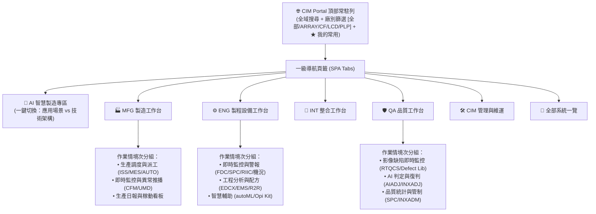

# CIM Web Portal 2.0 設計藍圖與分類規格書

> **專案代號**：`CIM-Portal-2.0`  
> **目標客群**：ARRAY / CF / LCD / PLP 各廠端使用者（MFG、ENG、INT、QA）與 CIM 內部同仁  
> **版本**：v1.0 (grill-me 決策完備版)  
> **制定日期**：2026-09-21  

---

## 📌 執行摘要 (Executive Summary)

現有入口頁面 (`iisstart.htm`) 為單一直列抽屜式連結清單，隨著 CIM 服務範圍擴展至 ARRAY、CF、LCD 等多元廠區，涵蓋即時數據、影像缺陷、智慧排程與大量 AI 智造工具，傳統分類已無法滿足不同角色的使用場景。

本次重構確立以 **「使用者角色 (Role) 為主要入口工作台」** 搭配 **「AI 智慧製造獨立旗艦專區」** 的雙軌架構，並導入 **「廠別 (Fab) 即時切換」** 與 **「作業情境次分組」**，打造直覺、高效且現代化的入口平台。

---

## 🏗️ 核心架構矩陣 (Multi-dimensional Architecture)



---

## 🧭 一級導航與分類規劃

### 1. 🤖 AI 智慧製造專區 (AI Smart Manufacturing Hub)
- **定位**：CIM 重點項目旗艦專區，讓全廠人員一目了然 CIM 提供之 AI 工具與賦能價值。
- **僅收錄**：已正式上線且具備 Web 介面之系統。
- **雙維度視角切換 (Dual-View Toggle)**：
  - **視角 A：落地應用場景 (Application-centric)** *(預設)*
    - 👁️ **視覺檢測與缺陷判定**：`AIADJ` (AI 缺陷輔助判定)、`INXADJ`、`Defect Library`
    - 📏 **精密量測與自動修補**：自動量測平台、自動修補指引
    - 🚨 **廠區安防與監控**：即時安全規範辨識、禁區闖入警報
    - 🏃 **人員動素與工時分析**：作業站動態效率分析系統
    - 🧠 **AI 核心平台與工具**：`UMS` (AI 統一管理服務平台)、`autoML` (自主機器學習訓練)
  - **視角 B：技術架構體系 (Technology-centric)**
    - 📷 **電腦視覺 (Computer Vision)**：Object Detection, Defect Classification, OCR
    - 📈 **數據與機器學習 (Machine Learning & Predictive)**：異常預警、趨勢預測、參數推薦
    - ⚡ **邊緣運算與即時推論 (Edge AI)**：現場 Edge Box 影像串流辨識
    - 📚 **生成式 AI 與知識庫 (GenAI & LLM)**：SOP 智慧對話助理、手冊檢索
    - ⚙️ **MLOps 與演算法平台**：`UMS`、`autoML`

---

### 2. 🏭 MFG 製造工作台
- **生產調度與執行**：
  - `MFG (iSS 智慧排程)`：全廠在製品調度與派工優化
  - `CFM / PLP CFM`：製造現場搬送與產線監控
  - `MES / AUTO Web`：核心生產執行與自動化介面
- **即時機況與異常**：
  - `機況推播系統`：重要機台狀態異常即時推播
  - `UMD`：機況警報與無人化搬送異常監控
- **報表與履歷看板**：
  - `MFG 生產報表`：產出、稼動率、瓶頸站追蹤看板

---

### 3. ⚙️ ENG 製程與設備工作台
- **即時監控與工程警報**：
  - `iFDC`：機台故障偵測與分類 (Fault Detection & Classification)
  - `SPC 異常排除`：工程管制圖越界警報與原因處置
  - `CF RIIC`：CF 製程即時警報與防錯系統
  - `UMD` / `機況推播系統`
- **工程分析與配方管制**：
  - `ENG (EDCX, EMS, EQBK)`：工程數據收集、設備維護與配方管制
  - `PLP ENG (EDCX)`：PLP 專屬工程數據系統
  - `R2R Web OPI`：Run-to-Run 製程閉迴路先進控制
  - `Opi Kit`：工程介面工具箱
  - `autoML`：製程特徵相關性與參數預測
- **工程報表與歷程**：
  - `ENG 工程綜合報表`：製程趨勢與機台參數追蹤

---

### 4. 🔬 INT 整合工作台
- **跨製程相關性與異常分析**：
  - `EDC/SPC 跨廠整合查詢`：ARRAY ↔ CF ↔ LCD 參數關聯性分析
  - `良率整合分析報表 (Yield Traceability)`：Lot 履歷良率與缺陷重疊對比
  - `Defect Library`：歷史缺陷特徵比對庫

---

### 5. 🛡️ QA 品質工作台
- **即時缺陷監控與管制**：
  - `RTQCS (TFT3 / 各廠)`：即時品質缺陷控管系統 (Real-Time Quality Control)
  - `INXADM`：品質資料管理與缺陷統計
- **AI 智能判定與復判**：
  - `AIADJ`：AI 影像缺陷判定系統
  - `INXADJ`：影像判定與覆核
- **品保手冊與標準**：
  - `Defect Library`、`SPC 異常排除手冊`

---

### 6. 🛠️ CIM 內部管理與維運
- **系統維護與值班**：
  - `值班工具 (Helpdesk)`：CIM 值班登錄、Issue 追蹤與交接
  - `App Manager`：CIM 應用程式生命週期管理
  - `使用率報表 (AnalysisReport)`：各系統點閱與服務利用率分析
- **資源與代碼資產**：
  - `Git Server`：內部代碼倉庫
  - `App Repository`：發布安裝包與工具程式庫
  - `Cloud Drive` / `內部檔案分享服務`：大型資料集與檔案交換
  - `備品管理系統 (SPMS)`：伺服器與硬體零組件管理
  - `UAC`：使用者權限與認證中心

---

## 🏷️ 多維度標籤與跨角色策略 (Cross-listing & Tagging)

| 系統名稱 | 主網址 / 廠區 | 適用廠別 | 歸屬角色 (多重標籤) | AI 標籤 (若適用) | 作業情境分類 |
| :--- | :--- | :--- | :--- | :--- | :--- |
| **RTQCS** | `.../rtqcs/tft3` | `ARRAY`, `CF`, `LCD` | `QA`, `ENG` | - | 即時監控與警報 |
| **AIADJ** | `.../aiadj` | `ARRAY`, `CF` | `QA`, `ENG`, `AI` | 視覺檢測 / Computer Vision | 即時監控 / AI判定 |
| **iFDC** | `.../FDC` | `ARRAY`, `CF`, `LCD` | `ENG`, `QA` | - | 即時監控與警報 |
| **MFG (iSS)** | `.../mfg/#/iss` | 通用 | `MFG` | - | 生產調度與執行 |
| **ENG (EDCX)**| `.../eng/#/edc` | 通用 | `ENG`, `INT` | - | 工程分析與配方 |
| **UMS** | `.../ums` | 通用 | `AI`, `CIM` | 平台服務 / MLOps | AI 平台與工具 |
| **autoML** | `.../auto-ml` | 通用 | `ENG`, `AI` | 數據預測 / ML | 工程分析 / AI工具 |
| **UMD** | `ptnecimumd...` | 通用 | `ENG`, `MFG` | - | 即時監控與警報 |
| **CF RIIC** | `priic...` | `CF` | `ENG` | - | 即時監控與警報 |
| **PLP CFM** | `.../plp-cfm` | `PLP` | `MFG` | - | 生產調度與執行 |
| **PLP ENG** | `.../plp-eng` | `PLP` | `ENG` | - | 工程分析與配方 |
| **值班工具** | `.../helpdesk` | 通用 | `CIM` | - | 維護與值班 |

---

## 🎴 系統卡片 (Rich Card) UI 規格

每張卡片皆包含以下標準元件：
1. **Header 區**：
   - 系統圖示 (支援官方 Icon 或高質感雙色首字母 Badge)
   - 系統名稱 (中文 + 英文代號)
   - ★ 收藏按鈕 (點擊切換，自動儲存至 LocalStorage 並在「★ 我的常用」同步顯示)
2. **Body 區**：
   - 一句話核心功能說明 (例如：「全廠製程設備 Fault Detection 即時警報監控與歷程查詢」)
3. **Footer 區**：
   - **廠別徽章 (Fab Badges)**：彩色膠囊標籤 (`ARRAY` 藍 / `CF` 綠 / `LCD` 橘 / `PLP` 紫)
   - **操作按鈕**：
     - 主要按鈕：「開啟系統 ↗」
     - 附屬按鈕：「操作手冊 📖」(若無手冊則隱藏或淡化)

---

## 🎨 視覺風格規範 (Clean Tech Light)

- **設計精神**：現代極簡、高清晰度、無干擾、長時間注視舒適。
- **色彩系統**：
  - 主背景色：`#f5f5f7` (經典淺灰柔和底)
  - 卡片背景：`#ffffff` (純白純淨)
  - 邊框與分割線：`#e5e5ea` / `#d2d2d7`
  - 主強調色 (Accent)：`#0071e3` (Apple Tech Blue)
  - 廠別專屬色：
    - `ARRAY`：`#0071e3` (科技藍)
    - `CF`：`#34c759` (生機綠)
    - `LCD`：`#ff9500` (活力橘)
    - `PLP`：`#af52de` (晶圓紫)
    - `AI Hub`：`#5856d6` (智慧靛藍)
- **頂部導航**：`rgba(255, 255, 255, 0.85)` 搭配 `backdrop-filter: blur(20px)` 毛玻璃效果。

---

## 📁 檔案架構規劃

為落實「資料與 UI 解耦」決策，Portal 前端目錄結構規劃如下：

```
D:\pam\30_projects\11_CIM-portal\
├── index.html              # 主入口 SPA (精緻現代 UI、導航、搜尋、卡片渲染邏輯)
├── portal-data.js          # 系統資料配置檔 (JSON 格式物件，CIM 同仁維護核心)
├── assets/                 # 靜態資源 (可選：自訂圖示、樣式)
└── iisstart.htm            # 原版備份
```

### `portal-data.js` 結構範例
```javascript
window.CIM_PORTAL_CONFIG = {
  version: "2.0.0",
  lastUpdated: "2026-09-21",
  fabs: ["ALL", "ARRAY", "CF", "LCD", "PLP"],
  systems: [
    {
      id: "rtqcs",
      name: "RTQCS 即時品質監控",
      code: "RTQCS",
      desc: "TFT/CF 缺陷影像即時檢測、警報與品質歷程分析",
      url: "http://tncimweb.cminl.oa/rtqcs/tft3",
      icon: "http://tncimweb.cminl.oa/rtqcs/tft3/RTQCS.ico",
      fabs: ["ARRAY", "CF", "LCD"],
      roles: ["QA", "ENG"],
      contexts: ["monitoring"],
      aiTags: [],
      docs: [{ title: "操作手冊", url: "http://tncimweb.cminl.oa/usermanual/rtqcs/" }]
    },
    {
      id: "aiadj",
      name: "AIADJ 智能缺陷判定",
      code: "AIADJ",
      desc: "基於深度學習之即時缺陷影像自動分類與輔助覆核",
      url: "http://tncimweb.cminl.oa/aiadj",
      icon: "http://tncimweb.cminl.oa/aiadj/favicon.ico",
      fabs: ["ARRAY", "CF"],
      roles: ["QA", "ENG", "AI"],
      contexts: ["monitoring", "ai_tools"],
      aiTags: {
        scenario: "vision",    // 視覺檢測
        tech: "cv"             // Computer Vision
      },
      docs: [{ title: "使用者手冊", url: "http://tncimweb.cminl.oa/usermanual/aiadj/" }]
    }
  ]
};
```
